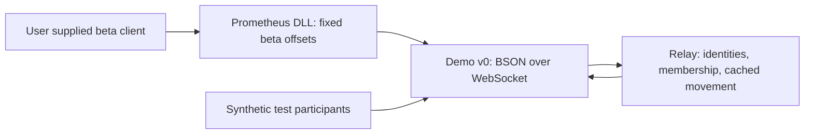

# Preservation architecture — 2026-10-12

The current implementation is a source-built beta client extension and an independently runnable **movement relay**. It is not a recreated Blizzard match server. Separate fingerprinted diagnostic launchers now start the supplied disc and final retail clients offline. The final process is unmodified; no final gameplay adapter exists (FINAL_RETAIL.md).

## Implemented boundaries

| Component | Responsibility | Evidence / limits |
|---|---|---|
| `prometheus/` | In-process rendering/debug UI, resource inspection, entity spawning and client movement access | DLL compiles; game behavior untested here. Hardcoded beta function addresses and layouts. |
| `protocol/legacy_wire.h` | Demo message IDs, BSON decoding, bounded field validation | Golden BSON document and malformed/schema tests. This is not Blizzard JAM. |
| `server/relay.*` | Transport-independent room with 12 participants, connection-owned IDs, hero and movement snapshot cache | Unit and actual WebSocket process tests. Positions are client supplied. |
| `server/main.cpp` | Standalone WebSocket listener, serialization of callbacks, structured diagnostics | Executable started by integration test. Defaults to loopback port 6969. |
| `prometheus/state_replicator.*` | Client transport and an optional embedded host using the same relay core | Compiled. Client receive pumping, cached hero updates and disconnect handling repaired; runtime pending. |
| `tests/` | Synthetic protocol fixtures, process/socket integration, read-only PE inspector tests | No original game assets or game execution. |
| `scripts/` | Repeatable Windows build and executable fingerprint inspection | Local full build script passed. |

The relay maintains `connected -> joined -> hero selected -> movement available` state. It replays each existing participant's join, latest hero and latest movement when a participant joins. Hero changes invalidate movement from the previous hero. Leave removes the participant once; reconnect creates a new connection identity. Each inbound message's player ID is replaced with the sender's socket ID. Connection identity is not an authenticated account.

The protocol retains upstream numeric IDs 1–5 and the exact movement field names from `prometheus/serialization.cpp`. No protocol-version envelope was added because that would break the existing adapter. Required vectors and scalars are checked before entering the game thread. Validation covers representation and ranges, not physical plausibility or correctness of hero resource IDs. Resource lookups are separately guarded in the client.

One room, no map negotiation, no team assignment, no authoritative simulation. Participants must choose the same map manually. Limits are 16 KiB decoded input, 480 message burst / 240 messages per second thereafter, 1 MiB outbound queue threshold, and a 4096-event client queue. IXWebSocket receives the frame before our size check: transport allocation limits and connection timeouts remain work. The room limit counts connections that have not joined yet. Explicit Leave ends membership and closes the sender's socket. Automatic client reconnect is disabled to make session changes explicit.

## Target boundaries and adoption decision

Choose Strategy D: validate the known beta adapter, retain reusable transport/validation/testing work, and add a separately identified retail adapter only after inspecting the target binary. Strategy A alone cannot preserve the final roster; Strategy B now has the supplied final retail binary but remains blocked on verified gameplay layouts and service integration; Strategy C cannot make fixed offsets independent of version merely by adding interfaces.

Future components must separate client presentation, input/prediction, versioned gameplay definitions, authoritative simulation, transport/replication, and account persistence. Only transport/replication has a standalone implementation today. Do not turn client-supplied `MovementState` snapshots into an authoritative movement model. A future match server must accept inputs and produce validated snapshots; damage, objective and ability rules require historical evidence and client integration.

Keep beta hook tables/layouts isolated from any retail profile. A profile must bind a verified executable SHA256 to expected instruction bytes, resource schema and protocol adapter, with rejection before patching if any check fails. Diagnostic disc patching has exact fingerprint/instruction checks; final startup has an exact fingerprint and applies no patches. The beta loader and final gameplay profile mechanisms remain work. `Inspect-Client.ps1` records the fingerprint but does not authorize a profile or patch the executable.

Local accounts, signed expiring sessions, lobby discovery, team configuration and match start/stop belong in future services. Plasmawatch's hardcoded login demonstration is not imported. No Blizzard authentication is called. The current unauthenticated relay is intended for local development; public hosting is not a tested deployment.
